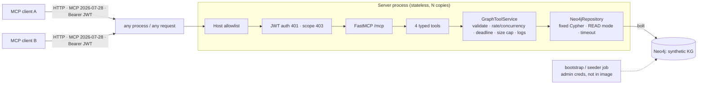

# graphrag-mcp-server

[](https://github.com/QiaomuLi150/graphrag-mcp-server/actions/workflows/ci.yml)  

A **read-only, authenticated GraphRAG knowledge service** exposed over the Model Context Protocol (Streamable HTTP).
Any MCP client discovers the same four typed tools and gets bounded, source-attributed evidence from a Neo4j knowledge
graph seeded only with **synthetic public data**. Open source (MIT), **$0 to run**: Docker + Neo4j Community, no cloud account, no LLM or paid API.

> **Status:** a local reference implementation, verified with live Neo4j, three MCP client stacks and CI on GitHub's free runners. "Stateless" here means request-level statelessness, demonstrated with two local server processes behind an alternating proxy ([docs/PROTOCOL.md](docs/PROTOCOL.md)); it is **not a production deployment**, not hosted anywhere, and makes no HA or scale claim. **Not deployed anywhere remote**:
> optional free hosting was evaluated, not verified ([docs/FREE_HOSTING.md](docs/FREE_HOSTING.md)). No production, HA or adoption claims.
> It is an MCP *tool provider*, not a chatbot: no LLM is in the request path.

## Run it (one command)
```bash
docker compose up -d --build --wait      # Neo4j Community + seed job + MCP server on http://127.0.0.1:28080/mcp
docker compose run --rm demo             # discovers tools and runs real requests (prints a transcript)
docker compose down -v                   # remove everything
```
Requires only Docker. Default passwords are local-dev only and everything binds to `127.0.0.1`.
To call it yourself, mint a short-lived dev token and connect any MCP client with `Authorization: Bearer <token>`:
```bash
docker compose run --rm --entrypoint python demo -m tools.dev_token mint --ttl 600
```
```python
from fastmcp import Client

async with Client("http://127.0.0.1:28080/mcp", auth=TOKEN) as c:
    print(
        (
            await c.call_tool(
                "find_relationship_paths",
                {"source_entity_id": "feat-gift-cards", "target_entity_id": "svc-ledger-service"},
            )
        ).structured_content
    )
```

## Tools (contract v1.0 — [docs/TOOL_CONTRACTS.md](docs/TOOL_CONTRACTS.md) has real request/response examples)
| Tool | Purpose | Bounds |
|---|---|---|
| `search_entities` | name/alias search (exact → prefix → substring), optional kind filter | query ≤ 200 chars, limit ≤ 10 |
| `get_entity` | one entity by stable id + attributed neighbours | neighbours ≤ 20 |
| `find_relationship_paths` | node-simple paths between two entities, shortest first | hops ≤ 4, paths ≤ 10 |
| `retrieve_graph_context` | link entities named in a question → supporting facts with provenance; abstains when unsupported | top_k ≤ 10, 500–12 000 chars |

There is deliberately **no `run_cypher` tool**: all Cypher is fixed, parameterised and run in READ access mode.

## Architecture

**Protocol: MCP `2026-07-28`** (`server/discover`, per-request `_meta`, no `initialize`, no session id); legacy handshake clients still accepted.
Two server processes behind an alternating proxy served the same client with 0 errors (see [docs/PROTOCOL.md](docs/PROTOCOL.md)).
Details: [ARCHITECTURE](docs/ARCHITECTURE.md) · [THREAT_MODEL](docs/THREAT_MODEL.md) · [RUNBOOK](docs/RUNBOOK.md) · [DEMO transcript](docs/DEMO.md).

## Verify it
```bash
uv sync --frozen && docker compose up -d neo4j
export GRAPHRAG_TEST_NEO4J_ADMIN_PASSWORD=local-dev-admin-pw GRAPHRAG_REQUIRE_NEO4J=1
uv run ruff check . && uv run mypy src tools && uv run pytest -rs
```
Last local result on Neo4j Community: **117 passed, 8 skipped** (7 need Neo4j Enterprise RBAC, 1 is a deployment-only smoke test; each skip prints its reason).
On Enterprise: 115 passed, 1 skipped. GitHub Actions workflow (`.github/workflows/ci.yml`: ruff, mypy, unit, integration on Neo4j Community, compose end-to-end,
image checks, Trivy, gitleaks, pip-audit) is written but **has not run yet** (no remote). Results, baselines and caveats: [docs/EVALUATION.md](docs/EVALUATION.md).

## Limitations (read these)
* Synthetic data (146 entities / 470 relationships); gold evaluation is templated and synthetic, so 100 % there says nothing about real-world retrieval quality.
* **Community Neo4j has no role boundary**: write protection = server-enforced READ access mode + fixed queries; use `docker-compose.enterprise.yml` for a real read-only role (local evaluation licence only).
* In-memory per-instance rate limiting; bearer tokens are valid until expiry; dev tokens come from a local key generated by the stack.
* Not tested against any third-party OIDC issuer or hosted platform; OAuth-discovery-only clients are unsupported.

Provenance and rights: [docs/PROVENANCE.md](docs/PROVENANCE.md) (nothing copied from the earlier tutorial repo). License: [MIT](LICENSE).
